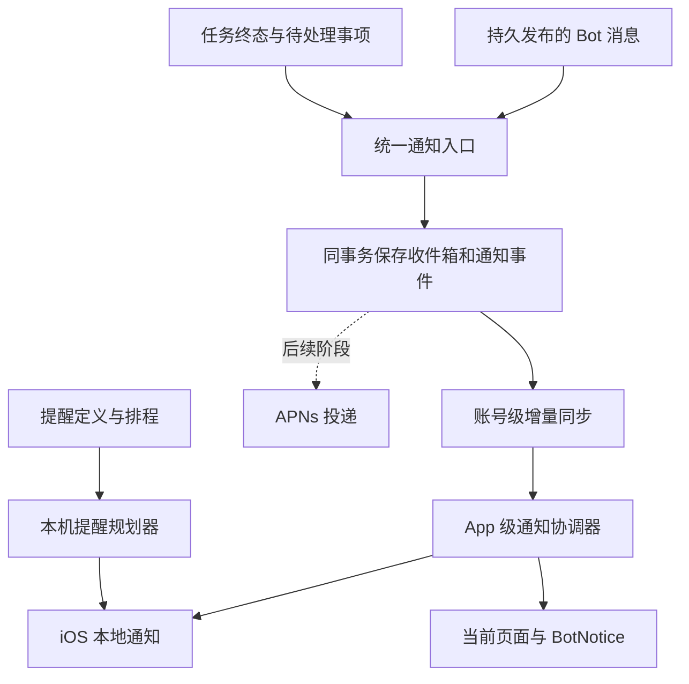

# VeraBot 统一通知方案：本地通知优先（讨论稿）

日期：2026-10-14。用户已确认首版覆盖提醒、Bot 新消息和任务结果。本文提出推荐设计，待讨论确认；不是实现或验收记录。

## 1. 目标与能力边界

让用户离开当前对话后仍能知道有新回复、任务完成或需要处理；已经同步并排入系统的提醒，在手机断网或 App 关闭后仍可触发。首版采用 iOS UserNotifications，不接入 APNs。

- **到点提醒**：App 预先把排程交给 iOS；触发不依赖当时连接后端。其他设备新增、修改、完成的提醒，须等本机同步后才能更新排程。
- **Bot 新消息**：App 活跃时接收服务端已发布消息事件；用户正在看对应内容时只更新页面，其他页面显示轻量提示。后台只有获得执行时间且收到事件时才能提交本地通知。
- **任务结果**：完成、最终失败、等待用户补充或审批均可产生通知；已落库结果可在重新打开 App 后补同步。App 挂起或关闭期间的新结果，首版不能保证即时触达。

通知不负责执行任务。普通私聊关闭后继续执行，仍依赖独立的持久执行能力，不能因接入通知就宣称已实现。定时任务和主 Bot 任务复用现有执行器，不重构它们。

Apple 明确说明：已注册的本地通知可由系统在 App 不运行时展示；后台刷新何时运行由系统决定。因此 BGAppRefreshTask 可作为补同步手段，不能作为即时消息通道或精确计时器。展示仍受用户的系统通知设置、专注模式等影响。

来源：[Apple 本地通知](https://developer.apple.com/documentation/usernotifications/scheduling-a-notification-locally-from-your-app)、[Apple 后台执行策略](https://developer.apple.com/documentation/backgroundtasks/choosing-background-strategies-for-your-app)。

## 2. 当前基础与待补缺口

本次静态核对基于本地 HEAD `5a91461` 及现有工作区；未运行测试、真实模型或真机通知。

- `NotificationCoordinator.swift` 已负责本地提醒注册、前台展示、完成／稍后动作和通知点按。
- `VeraBotCore/Notifications.swift` 已有规划器、深链接和离线动作队列；现有预算为最近 60 条、复杂规则未来 14 天，简单无限重复使用日历触发。
- `AppState+Reminders.swift` 启动／回前台时同步提醒、收件箱摘要与偏好，并注册设备。
- `services/notify/dispatcher.py` 已有统一入口、去重、收件箱、偏好、免打扰与限流，尚未实际发送 APNs。
- 定时任务、主 Bot 任务已调用通知入口；当前两者主要使用 `bot_message` 分类，任务通知会与普通消息混用偏好和限流。
- `notify/hub.py` 是进程内队列；`routers/chat.py` 只在聊天请求中订阅，iOS 收到通知事件也只触发提醒刷新。独立 Worker 的通知不能依赖这个内存队列传给 API 进程。
- 本地提醒规划仅接收 `preview`，未检查偏好总开关和提醒分类；设备注册也固定上报 `localReminders: true`。
- `scheduleSnooze` 把单条提醒传给全量 `apply`，规划器会删除同账号其余待发项；重复提醒的 reconcile 仅比较标题与 repeats，改时间但 identifier 不变时不会替换触发器。

以上是本次代码检查得到的缺口，实施时应通过针对性用例验证。

## 3. 方案选择

**推荐：统一通知事件，提醒预排程，消息／结果由 App 级同步投递。** 复用收件箱作为历史入口，增加可靠增量事件与设备投递状态；页面只消费展示状态。以后加入 APNs 时，继续使用同一事件、偏好和路由。

另外两种选择：只扩展聊天页通知，改动小但覆盖不了其他页面和独立 Worker；现在直接接 APNs，能补齐 App 关闭后的远程触达，但超出“先本地”的当前顺序。首版按推荐方案推进。

## 4. 用户体验

### 4.1 提醒

沿用提醒列表和收件箱入口。到点显示提醒标题与归属 Bot 名称，操作提供“完成”“稍后 10 分钟”；点按先进入只读提醒详情，再由用户选择编辑或查看来源对话。无日期提醒不排系统通知。

提醒不受 App 自设免打扰限制，沿用既有产品约定；仍遵守系统权限、总开关、提醒分类开关和既有 Bot 静音规则。备注及敏感内容不进入锁屏通知。

### 4.2 Bot 新消息

只在完整回复或重要等待提示持久发布后触发；每个流式片段、内部协作步骤及用户自己发送的消息不发通知。

- App 在前台，目标消息实际可见：更新对话，不额外弹提示。
- App 在前台，用户在其他页面或查看旧消息：使用既有 BotNotice，显示 Bot 头像、“有新回复”及查看入口；屏幕外内容保留未读。
- App 在后台且能收到事件：提交系统本地通知，默认文案为“「研究助手」有新消息”，点按定位对应消息。
- App 重开：补齐历史与未读，不逐条弹出离线期间的旧消息；需要时给一个可点击的汇总提示。

通知收件箱已读与对话消息已读分开管理；不能用现有收件箱未读数替代会话未读。完整消息阅读语义对齐现有《对话持续执行、Bot 状态与新消息方案》，属于相关依赖。

### 4.3 任务结果

新增独立 `task_result` 分类与设置，覆盖定时任务和主 Bot 持久任务。展示“任务名称：已完成／执行失败／需要你处理”，点按进入对应任务或结果消息。

一个任务结果产生的一条聊天消息与任务通知使用同一个逻辑事件，只提示一次。成功完成、需要用户处理、最终失败可提醒；执行中状态、工具调用、内部重试及每个小步骤静默更新。恢复同步时，旧完成结果静默入箱，仍有效的待处理事项集中提示。

## 5. 结构与数据流

### 5.1 服务端

继续由 `notify()` 负责业务去重、内容脱敏、分类和偏好。结果消息与关联通知保持事务一致；事件只能在提交后对客户端可见。投递失败仅重试投递，不重跑模型。

新增可回读的通知事件序列，建议接口为 `GET /api/notification-events?after=<cursor>&limit=100`，返回事件、下一游标、是否还有更多、服务器时间与当前同步上界。采用数据库持久事件供 API 和独立 Worker 共享，前台增量轮询即可完成首版；后续需要时在同一序列上加入 SSE，内存 hub 只做唤醒优化。

事件写入、序号分配与业务事务一起完成；当前 SQLite 写事务串行化下保证提交可见性，不把普通创建时间当游标。按账号授权读取，缺口／失效游标返回需要快照重建的明确状态。删除、已读与失效也有事件，避免其他设备长期保留旧状态。具体迁移版本实施时按当时主线分配。

事件至少关联：`event_id`、`notification_id`、`category`、`source_kind/source_id`、目标对象与版本、`message_id`／`task_id`／`run_id`、`reminder_id`／触发时间、`created_at`、`expires_at`、允许展示的标题／正文及投递策略。已有通知字段复用；缺失字段通过向后兼容扩展补齐。

首版前台建议每 5 秒增量读取一次；启动、回前台、网络恢复和完成本机操作后立即同步。连续失败按 5／15／30／60 秒退避，退后台停止周期轮询。后台刷新是后续可选优化，不作为首版交付前提。

### 5.2 iOS

由 App 级同步服务持有事件游标、账号代次与本机投递记录，通知生命周期不依赖 ChatView。

通知协调器统一负责权限、策略、系统注册、取消和路由；提醒规划器只生成期望排程，事件展示策略只决定静默、BotNotice 或系统通知。入口的系统代理应在应用启动早期注册，登录恢复后再处理暂存的点按目标。

本机采用 `(account, device, logical_event_id)` 防重复。同 identifier 重新注册可覆盖待发项；记录 `observed / scheduled / presented_in_app / opened / suppressed / failed` 等真实状态。只有确认系统接受注册才标 scheduled；不能把 scheduled 当 delivered，后台展示没有回调时不能编造送达回执。

事件先持久保存，再推进同步游标，之后尝试展示。重连和重复拉取不重复提示；投递失败保留有限重试及过期时间。首次启用、首次安装、登录、游标失效和长时间离线后先做静默快照同步，在本次同步上界建立新事件边界；历史只更新收件箱和汇总。短暂断线中未处理且仍新鲜的事件可提示，建议新鲜窗口 5 分钟；单次恢复最多一个消息／任务汇总提示。

任务和关联消息用同一逻辑 ID 去重；提醒用提醒 ID 与 occurrence 关联收件箱和本地排程。服务端到点事件仅刷新状态，不能再次提交即时提醒造成双响。

## 6. 提醒排程正确性

沿用最近 60 条作为本产品预算，统一覆盖预排提醒和稍后请求；给临时通知留余量。超出预算选择最近发生的项，在设置／调试中显示“已排程数量、下一次覆盖终点和等待补排数量”，不保证所有复杂提醒无限期覆盖。

- 全量 reconcile 只能接收完整期望集合；稍后动作使用定向更新，保留其他提醒。
- 对比完整触发器及内容，包括时刻、时区、星期、重复规则、正文、分类与路由；变化则替换。
- 简单无限重复使用带明确日历与时区语义的系统重复触发；有限次数、UNTIL、复杂规则使用服务端计算的具体 occurrence，按滚动窗口预排。提前提醒不能在简单重复优化时丢失。
- 明确区分固定提醒时区和跟随设备时区；沿用提醒业务的语义，不能用设备当前 Calendar 改写原提醒时区。跨时区和夏令时单独验收。
- 设置关闭、完成／删除、账号切换立即移除对应待发项及已展示通知；通知注册操作串行化，在每次异步边界复核账号代次，防止退出后的旧响应重新排程。
- 离线完成／稍后先保存本机操作意图和覆盖状态，再修改本机通知；同步排程须叠加未提交意图，防止服务端旧数据恢复已完成的提醒。稍后到期即消费本机覆盖状态，不因稍后操作尚未回传而反复响。
- 其他设备发生修改时，本机离线可能仍触发旧排程；这是本地首版的明确限制，回前台同步后纠正。

## 7. 权限、设置与路由

首次创建带通知的提醒，或用户主动开启通知时，解释用途后请求系统权限；不在首次启动时直接弹权限框。拒绝后保留提醒、消息和收件箱，显示系统设置入口。

系统权限属于设备，业务偏好属于账号：系统拒绝不能自动把整个账号通知总开关关掉。设置分别显示系统权限状态、账号总开关、提醒／Bot 消息／任务结果分类、声音、免打扰、内容预览和静音 Bot。服务端与本机采用同一套业务过滤规则；设备上报真实的本地通知能力。

沿用现有免打扰时间段，Bot 消息和任务结果受其限制；不在结束时补弹一批旧消息。普通对话消息需使用适合消息的聚合／频率规则，不能直接沿用当前每 Bot 每天 3 条的主动通知上限；主动任务进度仍保持克制。建议同一会话 30 秒内更新为一条汇总提示，等待处理与最终失败保留独立状态。

点按或动作在登录恢复后校验当前账号、对象归属、存在性和版本。尚未登录暂存目标；当前账号不匹配则清理旧通知，不自动切账号。提醒详情、结果消息和任务页均提供确定路由；任务可保留兼容分类用于旧客户端，但不能产生两次提示。现有 `bot/<id>` 的任务链接与私聊路由格式不一致，应改用统一路由生成器。

默认仅显示标题；敏感内容使用通用文案。系统通知用系统样式，前台提示复用现有小 Bot 形象。图标角标首版明确采用通知收件箱未读数，不与会话未读数相加；未同步期间允许滞后。

来源：[Apple 通知权限](https://developer.apple.com/documentation/usernotifications/asking-permission-to-use-notifications)。

## 8. 实施顺序与验收

1. **通知基础与提醒修正**：统一策略、权限／偏好分离、账号代次、完整 reconcile、定向稍后、离线覆盖、路由和排程状态。先证明已有提醒可靠。
2. **账号级事件与 Bot 消息**：持久事件及增量接口、App 全局同步、消息发布入口、当前可见性判断、前台提示、历史补同步与去重。普通私聊持续执行／会话已读能力作为相关依赖明确对接，不用通知层代替实现。
3. **任务结果接入**：独立分类、终态与等待处理事件、任务／消息单次提示、设置与结果路由；随后统一做真机验收。
4. **后续 APNs**：沿用同一逻辑事件与设备投递状态，补齐 App 关闭后的新消息／结果触达；本地已排的提醒避免再经远程重复提醒。

每一阶段的验证分为离线逻辑测试、API／数据库集成、iOS 构建和设备交互，分别记录，不用构建通过代替通知验收。重点用例：

- 关闭总开关／提醒分类后无待发项，恢复后只排有效未来项；系统拒绝不影响另一台设备偏好。
- 稍后只影响目标提醒，其他提醒继续触发；改重复时间、有限重复、提前提醒、时区／DST 正确。
- 离线完成／稍后后再刷新旧服务端数据，不恢复已取消排程；重复点动作不重复执行。
- 账号切换中迟到同步／注册／点按均不串号；冷启动点通知能恢复到正确目标。
- 当前对话可见回复静默，旧消息视口／其他页面有提示；完整回复只提示一次。
- API 与 Worker 分进程产生事件后仍可同步；重复事件、断线补拉、游标失效不漏数据、不重复提示、不弹历史洪水。
- 任务完成／最终失败／需要处理正确提示；同一结果的聊天消息与任务通知不双响。
- 锁屏、断网、App 挂起／关闭时已排提醒可触发；新远程消息与结果的本地阶段限制符合界面文案。
- iPhone 12 Pro Max 与 iPhone 11 分别验证系统权限、声音、预览、动作和路由，并记录真实设备结果。

## 9. 结论

推荐首版覆盖三个业务场景，底层采用统一事件和通知策略，分别通过提醒预排程与 App 级同步投递。先修正现有提醒路径，再补消息和任务结果闭环；APNs 留作下一阶段。本文只新增方案，不改变产品代码、现有状态文档或 Git 历史。
