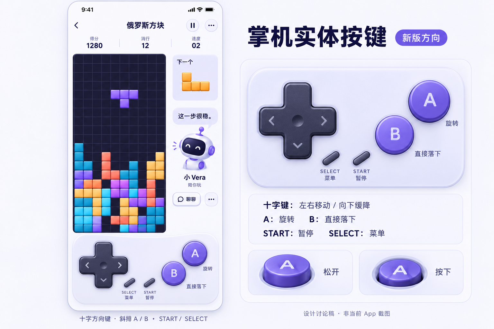
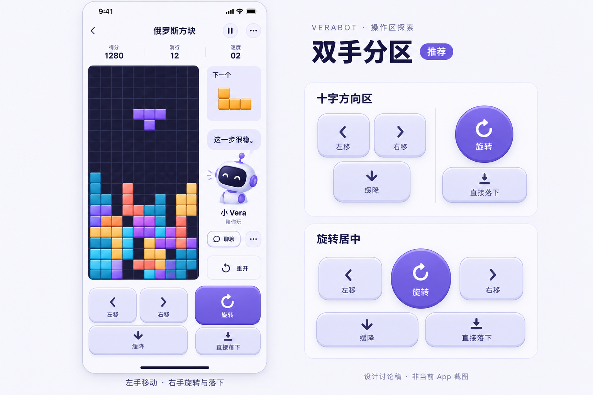

# 俄罗斯方块操作区设计图 v1

日期：2026-10-18。状态：设计讨论稿，未修改 App。用户要求先出一版设计图；操作按钮需要调整，具体形态尚未确定。用户允许使用 Figma，本轮使用内置图像生成工具制作高保真概念图，并未创建 Figma 文件。

## v2：按用户反馈参考经典掌机实体布局

用户进一步指定参考以前掌机的实体按钮布局。当前设计方向改为下图，v1 保留作比较，尚未改 App：

- 左侧一体十字键：左右移动、向下缓降；上方向暂不绑定，不把误触上方向变成硬降。
- 右侧斜排圆形 A/B：右上 A 旋转，左下 B 直接落下；以距离、位置和色阶区分。
- 中下方小型 START / SELECT：暂停/继续与游戏菜单；重开收进菜单，不用小键直接清空一局。可见键帽较小，实施时仍须保证足够命中区。
- 视觉采用哑光键帽、较薄底座、中心凹面和按下行程；实现时与已有震动同步，不照搬图像材质为不可缩放位图控件。
- 棋盘、右侧 Bot 和下个方块保留。图中角色、气泡与局面仍为示意；精确尺寸、上键处理与 A/B 映射均待体验评审。

使用内置 `image_gen` 编辑 v1，输出另存为 `docs/design/assets/2026-10-18-tetris-controls-handheld-v2.png`，原始输出保留于 `/Users/admin/.codex/generated_images/01a14eea-e442-7313-b687-536d53a1f4d2/exec-e75f1b8c-49e8-43ae-80bb-2493e8a521e7.png`。未使用 Figma。

最终编辑提示词（原文）：

> Edit this VeraBot Tetris design sheet into a refined CLASSIC HANDHELD-CONSOLE PHYSICAL BUTTON LAYOUT proposal. Keep its excellent Chinese typography, pale lavender/off-white native-iOS style, large main mobile screen on left, 10x20 dark indigo board with colored tetrominoes, compact score row, next-piece preview and companion robot on RIGHT of the board. Retain Chinese title 俄罗斯方块. This remains a concept design, not implemented App. Preserve the board's large scale and 1:2 ratio; do not let controller crowd out the board. Replace ALL of the previous rectangular key clusters and remove both old alternative panels on the right. Do not just rearrange existing rectangular buttons.
>
> NEW MAIN CONTROLLER BELOW BOARD: recognizable early handheld console ergonomics, with a SINGLE CONNECTED DARK GRAPHITE CROSS-SHAPED D-PAD on the LEFT, TWO ROUND PURPLE FACE BUTTONS diagonally on RIGHT, and TWO TINY SLANTED pill-shaped START / SELECT keys near lower center. This is functional UI inspired by tactile handheld consoles, not a photorealistic plastic device or branded console reproduction. D-pad is one connected plus-shaped molded key with subtle bevel, edge thickness and a center pivot dimple, matte charcoal-purple. Only the LEFT, RIGHT, DOWN arms have softly engraved arrow icons. The UP arm is visually blank and subtly less prominent: no upward movement, no accidental hard drop mapping. No extra D-pad arrows outside the cross. D-pad mapped functions: left/right movement, down soft drop. Upper arm deliberately unassigned in first design. Make entire cross approx112pt square; actual arms thick and thumb-friendly.
>
> FACE BUTTONS: circular A at upper-right position, circular B at lower-left position, classic diagonal arrangement about25-degree angle. A is purple #6461D1, diameter64pt; B is slightly lighter/more neutral purple, diameter56pt, at least16pt visible separation, each has matte top, narrow bottom edge and very restrained highlight giving tactile depth. Large crisp capital 'A' and 'B' engraved on their surfaces, no arrow icon inside. Chinese function labels just OUTSIDE each circle: A '旋转', B '直接落下'. Avoid visually merging the circles or showing shiny candy buttons. They must appear horizontally to right of D-pad rather than below D-pad. Small diagonal pill buttons SELECT and START near lower-middle but not under thumb's main path, 44pt invisible touch area concept though visible caps are small. Place subtle Chinese second labels '菜单' under SELECT and '暂停' under START. No action automatically restarts game: restart remains accessible via menu. Remove old large 重开 button from right rail, leave breathing room beside Bot; menu handles it. Preserve 聊聊 and companion options.
>
> Below main phone add concise caption '十字方向键 · 斜排 A / B · START / SELECT'. On the RIGHT of sheet, replace old variations with heading '掌机实体按键' and a small badge '新版方向'. Under it one LARGE BEAUTIFULLY RENDERED CONTROLLER DETAIL CROP on an off-white/lavender opaque surface, same D-pad/A/B/START/SELECT geometry as the phone, enough scale to clearly show its physical-key relief. It must exactly match the phone control layout. Under large detail crop put three succinct Chinese label lines, no long paragraphs: '十字键：左右移动 / 向下缓降', 'A：旋转    B：直接落下', 'START：暂停    SELECT：菜单'. At bottom-right tiny two keycap detail views labeled '松开' and '按下', showing one A key at rest vs pressed down slightly with shorter exposed edge; labels readable. These details explain physical feel without inventing extra in-app settings. Remove the previous '双手分区' title, '十字方向区' and '旋转居中' cards entirely. Keep bottom provenance '设计讨论稿 · 非当前 App 截图'. No logos of real console brands, no coins, no leaderboard, no takeover button, no added hold block, no unnecessary feature cards. Deliver a beautifully spaced, precise high-fidelity design sheet, landscape 3:2.

---

以下为 v1 记录。

## 设计意图

推荐主方案为双手分区：左侧左移/右移并排，缓降位于下方；右侧强化旋转按钮，直接落下独立放在下方。改变现有五键等宽横排，让位置、形状和轻重层次帮助建立操作习惯。落地时需要拉开旋转与直接落下的实际命中区，所有命中区至少 44pt，按压动画与此前震动统一。

图右侧提供两个探索方向：十字方向区（方向组合与圆形旋转），旋转居中（左右键围绕中央旋转、下方为缓降和直接落下）。这是按钮形态比较，并非三个已实现的操作模式。

顶部仅保留导航与紧凑数据；棋盘右侧保留下一个方块和 Bot，聊天/陪玩选项与重开仍有入口。不加入顶部陪玩大卡片、不覆盖棋盘、不展示尚未实现的接管按钮。紫色来自现有品牌主题。

## 概念图与实施的区别

- 图中 Bot 是角色示意，实际继续使用用户选中的现有 Bot 造型/照片，不据此替换头像体系。
- 气泡、分数和局面是示意内容，不代表真实对局或模型回复。
- 10×20 棋盘、当前方块与下个方块、五种动作、暂停和重开都保留；图像不作为精确像素尺寸、网格或规则验证依据。
- 连续按键、触摸取消、长按、暂停和后台行为仍需单独实现及验收；生成图不证明拇指可达或减少误触。
- 本轮只生成设计图及记录，不重新构建、安装、提交或推送。手机上仍是上一轮安装的版本。

## 生成方式与提示词记录

使用内置 `image_gen`，无参考图，生成新的 3:2 横向 UI 设计图，非 Figma 导出。原始输出保留在 `/Users/admin/.codex/generated_images/01a14eea-e442-7313-b687-536d53a1f4d2/exec-d7cfa3f1-52a9-4f50-8dda-cf0baf9343c1.png`，选定输出复制到本仓库 `docs/design/assets/2026-10-18-tetris-controls-v1.png`。

本次最终提示词内容归档（中文整理）：生成 VeraBot 俄罗斯方块 iOS 竖屏高保真设计讨论图，横向 3:2 画布，左侧为主要完整屏幕，右侧上下两块为仅操作区的替代方案。主屏幕以 393×852pt 为设计参考，使用现有紫色 #6461D1、浅紫 #EEEEFF 和克制的靛色棋盘，原生 iOS 导航、紧凑分数/消行/速度、10×20 正方形网格棋盘与真实四格方块，右侧为单个下块预览、Bot、短气泡、聊聊、伙伴选项、重开。禁止顶部陪玩卡、棋盘遮挡、接管按钮、排行榜、货币、关系等级、暂存和多块预览。主操作区采用左手左移/右移与下方缓降，右手醒目紫色旋转与分离的直接落下，至少 44pt 命中区，轻微实体按键底边与柔和高光。右侧替代方案分别为十字方向区和旋转居中。中文标签清晰；图中标注推荐、设计讨论稿与非当前 App 截图。Bot 为暂定角色示意，不替代现有角色。完整图不采用摄影、手持设备或夸张霓虹风格。

## 后续评审重点

先确定喜欢的分组和按钮形态，再讨论键间距、左右手习惯、长按连续移动以及缓降与直接落下的区分。正式实现前以可点击原型/真机确认小屏、横向拇指可达和误触；不直接按生成图锁定精确尺寸。
