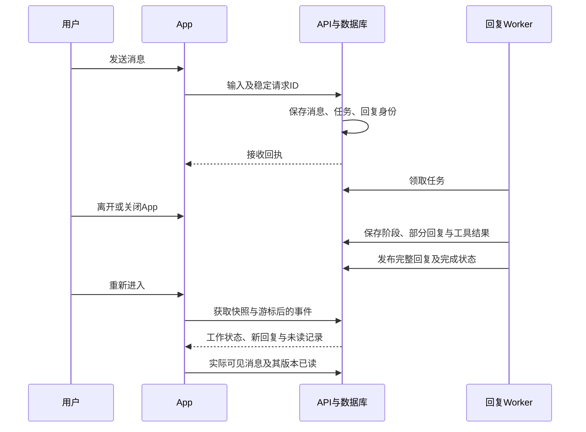

# 对话持续执行、Bot 工作状态与新消息方案

日期：2026-10-14。状态：设计方案，待评审；尚未实施本功能。

本方案承接 2026-10-13 的讨论稿，以本地 main `5a91461`、源码 schema v29 为当前依据。主 Bot 产品提交 `b68dfc4` 已合入，不能继续采用讨论稿中的“主 Bot 尚未开始实现”判断。仅静态核对源码和交付文档，未重跑测试、调用模型或操作验收环境。

## 1. 目标与范围

用户发送一条消息，服务端接收后，Bot 独立完成回复和获准的工具工作。用户返回列表、切换页面、进入后台、关闭 App 或手机暂时断网，都不取消这项工作。列表中对应 Bot 的头像表达实际工作状态；重新进入时能恢复进度，并识别离开期间的新回复。

这是所有 Bot 的基础对话能力，普通发送无须先设主 Bot、开启主动任务或额外创建任务。显式交办和周期任务继续使用已有主 Bot 任务功能。

本期交付包含普通私聊的后台回复、附件与原有工具行为、审批等待及回接、列表工作状态、私聊与群聊的新消息和阅读记录、断线重进恢复、停止与故障处理。群聊执行沿用群 v2，新增共同的会话展示和阅读能力。

不把自动发现新目标、所有执行器整体重构、新任务中心或即时推送纳入本期。App 关闭后继续执行要求后端持续运行；App 关闭时立即提醒另外接入 APNs。

## 2. 用户体验规则

### 2.1 发送、离开与重进

1. 点发送立即呈现用户消息和回复占位，先显示“正在发送”。提交载荷及稳定请求 ID 保存在本地。
2. 服务端原子保存输入、任务和回复身份，再返回接收回执。收到回执后展示排队或真实执行阶段。
3. 页面离开只结束该页观察与朗读，不发停止请求。后台或关闭 App 不改变服务端执行状态。
4. 重新进入先显示本地内容，再同步消息、任务快照和事件；仍在执行则恢复部分回复并继续观察，已结束则显示完整结果。
5. 未收到回执时显示“发送结果待确认”；恢复网络后用原请求 ID 查询或重放同一提交，不能自动生成新 ID 再发一次。

“持续执行”的承诺从服务端持久接收开始。消息尚未传到服务端、用户显式停止、需要补充或审批、额度不足、后端故障，均需呈现真实状态，不假装正在正常工作。

### 2.2 后续输入与并发

每个私聊会话最多一个正在执行的普通回复，后续普通消息顺序排队并显示“排队中”。新消息不自动取消前一条，用户可显式停止当前回复或取消尚未开始的消息。

需要处理审批或等待补充时，通过绑定原任务的卡片提交；不能将任意“好的”解释为同意某项外部操作。同一会话存在等待中的任务时，输入区提供明确的“回复此问题”关联；用户退出关联后可发新的独立消息。等待任务释放执行槽，不阻塞独立闲聊。

每条排队输入都保存关联任务、消息顺序和上下文边界。执行时加入已完成的前序回复，排除后续排队消息；回答等待项携带准确任务版本。多个等待任务的回答必须绑定其问题，不能只依据最近一次头像状态推断。

不同 Bot 可独立执行。初始采用服务端可配置的全局与账号并发限制；超出上限排队，不无限创建模型请求。普通回复和主 Bot 任务共享账号预算校验，但保留各自策略与累计调用记录。

### 2.3 列表中的 Bot 状态

复用现有头像动作：回忆、思考、执行、委派、回复、等待确认、成功、失败。头像状态来自后端阶段；动画结束不代表任务结束。

- 排队：常态头像，摘要显示“排队中”。
- 思考／回忆：对应现有动作，摘要显示“正在思考”或“正在整理上下文”。
- 查询／工具：执行动作，显示可公开的“正在查询／处理”，不暴露敏感参数。
- 委派：委派动作，显示“正在协作”。
- 生成：回复动作，显示“正在回复”。
- 需要用户：等待动作，显示“等你补充”或“待你确认”。
- 完成：短暂成功反馈后回归常态；最新回复和未读提示保留。
- 失败／中断：静态提示和原因摘要，提供重试或查看入口，不无限播放错误动画。

运行状态与未读数分开：正在处理下一条消息时，上一条未读仍保留标记。照片头像保留照片，以外围提示、短文案和无障碍描述表达状态。主 Bot 身份徽章、置顶和未读提示使用不同位置与语义，避免互相覆盖。

私聊 Bot 行汇总该 Bot 的普通回复任务，以及已投递／将投递到该私聊的 owned task。优先级为：需要用户处理 → 当前私聊回复阶段 → 其他执行中工作 → 排队 → 需处理的失败／中断 → 空闲。运行项不止一个时显示“另有 N 项进行中”，进入后分别查看，不能用一个状态覆盖所有任务的事实。

群工作只在群会话行显示负责人和状态，不自动混入成员 Bot 的私聊工作。Bot 身份徽章与群内负责人保持独立。

只在可见列表行运行必要动画，减少动态效果时使用静态状态。断网保留最后同步结果，并显示“待同步”；没有收到事件不等于任务停止。

### 2.4 新消息与已读

列表显示每个会话的未读 Bot 消息数，超过 99 显示 99+。进入对话时，在首条未读回复前插入分隔线：浅蓝色细发丝线贯通宽度、正中「新消息」、字两侧横线断开，无 pill/胶囊底（`NewMessagesDivider`，私聊与群聊共用）。单条未读同样用这条分隔线。不在 Bot 头像或气泡上方另挂「新消息」或未读提示。群聊适用相同阅读规则。

普通进入时定位到第一条未读附近；若从通知或搜索进入，则优先定位目标消息并保留其他未读。用户已经滚动阅读旧内容时，不强制跳到底部，以“有新回复”入口提示。

仅当 App 在前台、聊天页确实可见，且回复正文进入可见区域时上报已读。建议以正文或卡片可见至少 0.5 秒作为首次实现阈值；长回复无需全文滚完，但不能仅因屏幕边缘出现一个像素便标记。临时覆盖、后台、列表可见和消息预加载都不算阅读。

进入时记录本次未读集合，阅读中新增消息也加入本次集合。已读成功后列表计数更新，但本次「新消息」分隔线保留到离开对话；下一次进入按服务端最新记录计算。另一个设备的已读同步不会让当前分隔线突然消失。

未读只计算已发布的 Bot 消息、求助和审批提示。自己的消息、工具轨迹和每个流式片段不加计数；同一回复有多个更新时只算一条。已看过部分文字、离开期间才完成的回复，完成版本仍是未读。

正常完成发布一次；等待用户／审批时发布实际问题；任务真正失败或中断时发布一条可读说明。自动重试和细分工作阶段只更新状态，不制造重复消息。

## 3. 当前底座与接入选择

当前私聊 `api/routers/chat.py` 在 StreamingResponse 内调用 `agents/runtime.py::run_chat`，普通回复仍依赖请求执行。群 v2 已有独立提交、任务快照、持久事件与 Worker；owned_tasks 已有步骤、租约、幂等、预算、等待项、审批回接和独立进程。

owned_tasks 的 executor 当前采用非流式 `llm.complete`、结构化任务结果及受限工具策略，delivery 将结果作为“任务进度”消息投递。它不能直接替代包含流式文本、记忆写入、附件和原有委派语义的普通聊天。简单调用 owned task 创建接口会改变正常聊天行为。

选用“独立私聊回复任务 + 共用会话展示协议”的接入方式：普通回复保留聊天运行器，执行由独立 Worker 驱动；群和 owned task 保留现有业务执行器，通过适配器提供状态和可读消息。复用已验证的幂等、版本防护、预算和审批模式，必要的小型公共函数按实际重复提取，不先建设通用大引擎。

## 4. 前后端职责与流程

后端职责分为：提交与回执、回复执行、结果发布、会话摘要及阅读记录。App 职责分为：账号级状态同步、本地持久缓存、聊天呈现和实际阅读上报。

Worker 是独立进程，API 只负责提交、读取、观察和控制。收到请求前先校验账号、Bot、预算和附件；领取及执行时再次核验权限、任务版本和会话代次。

执行器消费聊天事件并持久化，而不是向某个 HTTP 连接直接执行模型。模型及工具运行不能被观察连接取消。运行器需要分离“上下文／模型／工具推进”和“消息保存／事件发送”；消息最终保存由任务提交路径统一负责，避免旧 finally 和新 Worker 各写一份回复。

保留普通私聊的记忆读取与写入、附件读取、敏感内容处理、工具轮次及委派限制；后台运行不自动扩权。记忆提取／摘要等既有后处理以最终消息 ID 去重触发，失败不会将已完成回复重新执行。

## 5. 数据设计与一致性

### 5.1 私聊回复记录

建议新增 chat_reply_tasks、chat_reply_events、chat_tool_attempts、chat_input_receipts，保存 user_id、bot_id、conversation_generation、client_request_id、payload_hash、input_message_id、output_message_id、state、phase、version、lease、预算、错误及检查点。

普通回复状态：queued、running、awaiting_user、awaiting_approval、retry_wait、completed、failed、stopped、interrupted。思考／查询／委派／生成等作为 phase，与持久业务状态分离。

提交事务内一次创建用户消息、稳定回复身份、任务、回执和账号事件。请求 ID 按账号及会话唯一；相同 ID 同载荷返回原回执，不同载荷返回冲突。附件绑定同一用户消息，重复提交不重复绑定。

回复从占位到部分结果再到终态始终使用同一个 output_message_id，避免重进后产生两个气泡。为新回复增加明确的 message_status 和会话内顺序：发送时保留“用户消息／对应回复”的顺序位置，后续排队消息不因最终回复晚保存而乱序。

历史上下文只包含运行任务边界内的已完成消息与当前输入，不纳入空占位、未完成后序消息、过时版本或已删除内容。旧消息保留原顺序并获得稳定映射；原来没有状态字段的历史消息按已完成处理。

部分文本按时间或大小批量保存，初始建议最长 1 秒或累计 256 个字符刷新；重要状态立即保存。最终正文、完成状态、发布版本、未读基础数据和对应事件在同一事务落地。等待审批的冻结参数与任务关联同样原子保存。

### 5.2 会话摘要与消息发布

新增 conversation_activity、conversation_events、message_publications，提供类型、会话 ID、代次、最近消息、工作状态、待处理项、未读数、修订号及账号级事件游标。

三个业务来源分别适配：普通私聊任务、群任务、投递到私聊的 owned task。任务执行者的版本与会话消息的发布版本是两种身份，不混用。

每条可读消息有稳定身份及单调递增的 publication_revision。发布序号用于同步；正文片段版本只用于恢复流式内容，不每片段生成一个可读发布。求助更新或最终完成才推进可读版本。

owned task 及群回复在现有结果投递事务内增加发布关联；通知偏好、免打扰或收件箱投递失败不影响会话未读。群澄清若当前保存为独立任务对象，则投影成带稳定消息身份的可读问题，不能依赖临时 UI 卡片计算未读。

### 5.3 阅读记录

新增 message_read_receipts，按账号、会话类型、会话 ID、会话代次、消息身份保存最高已读发布版本。消息发布与阅读使用服务端版本，不使用客户端时间判断。

上报具体可见消息和版本，服务端只允许向前推进、不能超过已发布版本。未读数按仍存在且最新发布版本高于其已读版本的 Bot 消息去重计算。

单个 last_read_message_id 或一个最高游标不足以表示“看过后面的消息，前面的还没看”。本方案用逐消息记录保留这种空洞；以后需要压缩时可合并连续已读区间，不改变语义。

读过部分生成文本不等于读过最终回复。生成中 UI 可以展示“新回复·生成中”；最终发布后，只有其完成版本实际可见才标记完成版本已读。

### 5.4 初次升级与删除

迁移从实际当前版本顺延，当前基线预计 v30 起。迁移前备份并用隔离数据库演练，不在方案阶段升级正在验收的服务。

迁移事务为已有消息建立发布与已读基线，默认不把全部旧历史突然变成未读；迁移后新发布的 Bot 消息进入正常未读逻辑。收件箱未读继续独立，不能被迁移顺带清空。

会话清空推进 generation、停止该会话普通回复、取消排队、清理对应阅读状态。旧事件及 Worker 迟到结果因 generation 不符不能恢复正文。owned task 的任务中心记录保留，但该次投递仍绑定旧代次，不能把清空前成果重新投递到新会话。

删除正在运行任务的输入或回复，应停止对应普通回复并抑制后续投递；删除普通历史消息沿用原有单条删除语义。删除 Bot 使用现有业务规则并终止其普通回复；群历史与 owned task 的既有保留／暂停规则分别处理。

## 6. 建议接口契约

以下是新协议的接口建议，具体字段在实施计划中与现有 API 命名校准。

- `POST /api/bots/{id}/chat/inputs`：提交稳定 client_request_id、正文、附件、预期会话代次及可选等待项引用；首次接收返回 202，幂等重放返回 200。回执包含任务、输入／回复消息身份、代次、版本和同步游标。
- `GET /api/bots/{id}/chat/inputs/{request_id}`：查询是否已持久接收。不存在时可以重放原 ID 提交；网络错误不能解释为未接收。
- `GET /api/bots/{id}/chat/execution`：读取当前运行／等待／排队任务及部分回复快照。
- `POST /api/bots/{id}/chat/tasks/{task_id}/stop`：携带 expected_version 和稳定控制请求 ID，幂等停止当前或排队任务。
- `POST /api/bots/{id}/chat/tasks/{task_id}/inputs`：明确回答等待项或恢复任务，携带 wait_id、expected_version 和稳定请求 ID；审批沿用原 action 接口并校验任务关联。
- `GET /api/conversations/activity`：获取账号级会话摘要快照及 cursor，支持增量修订或分页。
- `GET /api/conversations/events?after_id=...`：一条账号级前台 SSE，发送摘要变化、发布、已读和删除事件，包含事件 ID、会话代次与修订。
- `GET /api/bots/{id}/chat/events?after_id=...`：当前私聊的正文／工具／阶段事件；使用账号事件得到的任务或会话身份去重。
- `POST /api/conversations/{kind}/{id}/read`：批量提交具体消息身份及最高可见 publication_revision，校验会话代次。

账号摘要快照与返回 cursor 必须来自一致读事务；分页固定快照版本。客户端先应用快照，再消费 cursor 之后的事件。事件过期或代次不符时返回明确的重同步原因，不能静默跳过缺口。

旧 `/chat` 暂时保留用于旧客户端，并明确不承诺新的连续执行能力；同一会话已有新协议任务时旧提交返回可理解的忙碌冲突，避免双执行。新客户端不得在新版提交超时后自动降级重发旧接口。历史读取对旧客户端过滤未发布占位，保留已完成消息。

## 7. iOS 结构与生命周期

在 AppState 中增加按服务器、账号及登录代次隔离的 ConversationActivityRepository。它管理摘要快照、账号事件连接、读取记录和本地 SQLite 缓存，列表及聊天页只读取它的结果。

ChatViewModel 使用提交回执与任务观察接口，保留部分回复、工具卡片与输入草稿；不再把执行状态仅保存在页面内。ConversationRepository 扩展新消息状态、稳定身份、会话顺序和发布／阅读版本。

前台只保持一条账号摘要连接；进入聊天页再开当前会话详细观察。返回列表关闭详细观察，不发 stop。后台允许观察断开；回到前台立即校准快照、待确认提交及游标，再恢复观察。

退出账号／更换服务器立即取消旧订阅、使旧回调失效并切换本地缓存空间；不默认为撤销服务端已接收的工作。已读上报在网络失败时存入幂等 outbox，切换账号不将其投递到其他账号。

朗读仍遵守原规则：离开聊天页停止、后台停止，不因后端持续工作而自动在列表或其他页面播放。麦克风、相机临时覆盖及输入焦点保持原有生命周期。

## 8. 执行可靠性、权限与部署

每个领取步骤带租约和版本；模型调用前、工具执行前、结果提交及安排后继时核验当前身份。API 停止先持久改变状态，独立 Worker 在运行中定期检查，不依赖 API 进程内取消对象。

每个工具调用保存稳定调用身份、冻结参数、状态及可核查结果；外部写入走原有确认与最小权限策略。重连、重开、回执重放只重读已有结果，不触发工具重跑。

临时网络问题有限重试；结果确定未执行的安全只读步骤可以恢复。已完成的工具结果作为检查点复用；模型流在后端故障时可能中断，保存部分内容并显式呈现 interrupted。外部动作结果未知先查询或等待用户决定，不能承诺任意动作严格执行一次。

审批任务复用 owned_tasks 已有冻结参数、一次性领取与确认回接模式，并扩展到普通回复的任务类型。审批拒绝／过期、权限撤回、定义变更和预算不足都保存原因；更换页面不能绕过确认。

本期部署保持当前单机 SQLite 及群单 API 进程约束，新增独立回复 Worker，保留现有 owned Worker 和 Scheduler。部署须验证持久目录、常驻监督、重启与网络可达性。运行器间采用数据库领取与预算记录协调，不据此宣称已经支持多实例部署。

手机关闭不影响持续在线的后端。本地电脑睡眠、服务停机或上游故障会影响推进；恢复后按检查点处理。APNs 不参与执行正确性，只在后续即时通知需求中接入。

## 9. 实施阶段与交付门槛

### P0：契约、迁移与兼容基础

冻结消息身份、会话代次、任务状态、发布／阅读版本和接口。新增私聊任务、回执、工具检查点、账号事件与阅读存储；完成旧历史升级基线、清空删除以及旧客户端兼容设计。

交付门槛：隔离库升级不丢消息；同 ID 重放只创建一份输入和任务；稀疏已读不误清其他消息；旧代次写入被拒绝。

### P1：私聊持续执行闭环

将聊天运行与 HTTP 观察分离，接独立 Worker、流式快照、停止、排队、附件、记忆、工具和审批回接。保持普通聊天原有能力，不套用 owned executor 的受限策略。

交付门槛：真实本地 socket 断开和客户端退出后，假模型任务继续完成；重进同一回复身份；用户消息、工具动作及最终回复均不重复；停止后无迟到正文。

### P2：列表工作状态与新消息闭环

App 级摘要同步、照片与形象头像状态、Bot／群未读数、消息标签、阅读可见性、跳转优先级、本地 outbox 和双设备同步。将 owned task／群投递接入消息发布，保留各自执行器。

交付门槛：页面间状态一致；任务和未读可同时展示；屏幕外不误读；部分回复离开后完成仍标新；当前阅读标签不因已读提交或另一台设备阅读立即消失。

### P3：恢复、常驻运行与用户验收准备

覆盖重启、租约失效、审批竞争、消息删除、账号切换、事件缺口、预算和部署监督。准备一个隔离真实模型任务，用户自行验收页面、头像与阅读体验。真实外部写入仅按单项明确授权验证。

交付门槛：持续在线部署下，App 后台及关闭后任务完成，重开结果可见；故障后状态诚实且已完成动作不重放。自动回归、真实模型、模拟器／真机与用户验收分别记录。

APNs 可作为之后的独立阶段；它不阻塞本期“关闭 App 后继续、重开后查看”的交付。

## 10. 验收场景

1. 发送后立即返回列表、切设置、进入另一个 Bot：原回复完成，头像实时反映状态。
2. 已接收后后台、关闭 App、手机断网：后端继续，恢复后正文与工具结果完整。
3. 请求已接收但回执丢失：重开查回执，无重复输入、任务、附件或费用记账。
4. 生成中离开、生成中返回、完成后返回：同一气泡，部分文本可恢复，新回复标签正确。
5. 同一 Bot 连发两条、不同 Bot 并行：前序上下文正确，顺序稳定，预算及排队状态真实。
6. 等待补充与审批：回答绑定正确任务；重复确认、拒绝、过期、停止后批准均无重复执行。
7. 先读后面再读前面、长回复、屏幕外消息、通知跳转：逐消息已读正确，不误清未读。
8. 双设备阅读和本次标签：服务端计数同步，本设备阅读过程稳定；账号切换不串数据。
9. 清空会话、删除运行输入／回复、删除 Bot：旧事件和迟到结果不恢复已删除内容。
10. 服务重启和外部结果未知：保存的工具结果被复用；未知动作不会盲目重复。
11. 头像照片、十一种形状、主 Bot 徽章、减少动态效果和无障碍：身份与工作状态清晰可辨。
12. 群聊与 owned task 新结果：未读统一，执行及上下文边界不变；收件箱免打扰不吞掉会话消息。

## 11. 评估与风险

产品价值高，技术可行，整体难度中高。主要工作量在普通聊天执行器拆分、工具及审批恢复、消息身份与兼容迁移、账号级同步和阅读空洞处理；头像本身属于较小部分。

最高回归风险是聊天能力丢失和重复工具动作；用普通聊天专项回归、幂等／迟到结果验证及可审查检查点控制。其次是消息乱序／误读，通过稳定回复身份、会话顺序、逐消息阅读版本与双设备场景验证。

已有群与主 Bot 代码降低模式探索成本，但其用户验收仍独立跟踪。不能将主 Bot 已合入等同于普通聊天持续执行已交付，也不能用假模型结果宣称真实外部操作可靠。

估算应在 P0 契约核对及实施项拆解后给出；当前不承诺精确天数。全量执行器重构、APNs 和生产基础设施建设应独立估时。

执行前使用隔离工作树，核对当前 HEAD、迁移编号及并行修改。每阶段仅提交本功能文件，保留现有界面、文档及其他验收环境；不在实施期间自动操作用户的手动验收流程。

## 12. 方案结论

采用后端独立回复任务，使普通聊天脱离页面生命周期；通过账号级会话状态同步驱动列表头像；用稳定消息身份、发布版本与逐消息已读实现新消息体验。

先落实执行正确性，再完成状态与阅读闭环，最后完成常驻部署和用户验收。方案确定后，另写按文件、接口和验证项拆分的实施计划；本文件不授权开始编码、提交、迁移数据库或替换验收 App。

## 变更记录

### 2026-10-14 · 未读分隔线样式（`fix/group-member-remove`）

- 多条未读时的「以下是新消息」改为 Boss 参考样式：浅蓝发丝线 + 居中「新」、无胶囊底；私聊 `ChatView` 与群聊 `GroupChatView` 共用 `NewMessagesDivider`。仅样式，阅读/定位逻辑不变。
- 同日更正：去掉 Bot 上方的「新消息」未读提示。分隔线文案改为「新消息」，两侧横线；一条未读也在该条前显示分隔线。
